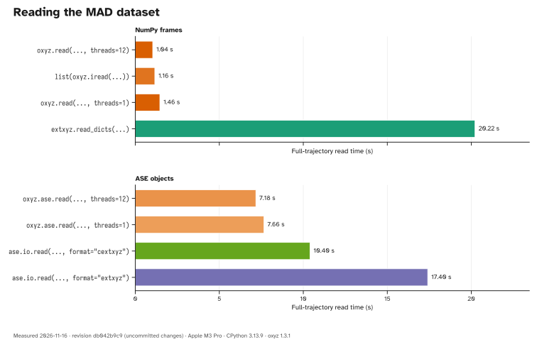

# Performance

## Reading a real dataset

The MAD-1.5 r²SCAN training set contains 180k structures (2.63 M atoms) across molecules,
crystals and surfaces. ASE timings include conversion to `ase.Atoms`.

[Dataset (v3)](https://doi.org/10.24435/materialscloud:ak-4p) ·
[Paper](https://arxiv.org/abs/2603.02089) ·
[CC-BY-4.0](https://creativecommons.org/licenses/by/4.0/)

## Scaling with dataset size

Synthetic trajectories with a corpus-shaped distribution of frame sizes.

[![Dataset scaling: read time and same-output speedup.][scaling]][scaling]

[scaling]: assets/benchmarks/scaling_dataset.svg



[Complete results](reference/benchmarks.md) · [Raw timings][saved-run] ·
[Reproduction instructions](development/performance.md#reproduce-the-published-snapshot)

[saved-run]: assets/benchmarks/oxyz-performance-7b819e8b0e.json
